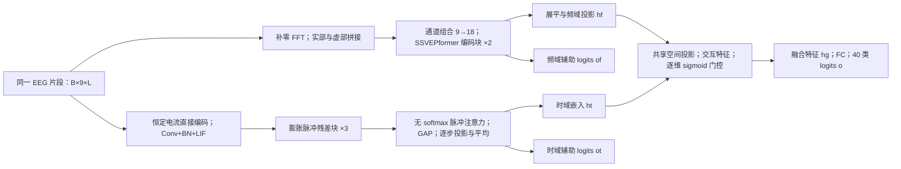

**SpikeTFNet：Benchmark 数据集复现计划与结构核对记录**

版本：v0.1（前期分析归档）；日期：2026-10-19。后续已收到第 8 页和用户实施授权，当前参数决策以 [实现说明](G:/SSVEP/SpikeTFNet/docs/IMPLEMENTATION_NOTES.zh-CN.md)、[配置](G:/SSVEP/SpikeTFNet/config.py) 和 [运行说明](G:/SSVEP/SpikeTFNet/README.md) 为准。下文保留当时的分析过程，其中已解决的待定项不再阻止实施。

本轮只完成论文审阅、数据元信息检查和计划制定，未实现模型、未运行训练、未修改原始数据。本文是后续实施基线；用户补充要求后，应更新本文及决策记录，再冻结实验配置。

**1. 行动目标和完成标准**

仅使用 `G:\SSVEP\data\benchmark`，复现论文 Dataset 2 上的 SpikeTFNet：复数频谱分支、脉冲时域分支、样本及维度自适应门控融合，以及融合主任务与两分支辅助任务的联合监督。

实验目标为无目标被试校准的 40 类跨被试识别，采用 35 折 LOSO，评估 0.5、0.6、0.7、0.8、0.9、1.0 s 六种数据窗。结构一致性、预处理一致性、数据隔离和结果可追溯性均须通过核对后，才能评价复现程度。论文结果表缺失，因此目前不能设置“达到原文某准确率”的数值验收线。

基础交付包括模块化模型、可追溯配置、数据与划分清单、检查脚本、训练和评估入口、逐被试预测与指标、汇总结果以及差异说明。对照模型和正式消融实验暂不自动扩展到本次工作范围，等待用户后续要求。

实施完成的判断分成三层：结构和数值流程符合已确认规格；35 折与六个窗口按冻结协议完成；在取得原文结果及完整实验设置后，再评价数值复现差距。仅训练能够收敛，不代表已忠实复现。

**2. 依据与证据等级**

主要依据为用户提供的 [论文 PDF](C:/Users/Administrator/Desktop/SpikeTFNet.pdf)，标题为 *SpikeTFNet: A Hybrid Spiking Temporal-Spectral Fusion Network for Cross-Subject SSVEP Decoding*，DOI 为 `10.1109/JBHI.2026.3734285`。文件为 7 页，SHA-256：`43e776bf4c8efc161640c702e7f96c48eb1d5b2d715616c1d9e386564b65af35`。

已完整阅读文本，并视觉核对第 3–7 页、图 2、图 3 及关键公式。第 7 页 G 节实验设置在句中截断；本文件没有后续训练参数、完整指标定义、实验结果表与参考文献列表。不能将缺失内容推测为原文规定。

本地依据包括 [数据说明](G:/SSVEP/data/benchmark/Readme.txt)、[电极表](G:/SSVEP/data/benchmark/64-channels.loc)、[频率与相位](G:/SSVEP/data/benchmark/Freq_Phase.mat) 及 35 个被试文件的 MAT 元信息。已保存 [元信息核验记录](G:/SSVEP/SpikeTFNet/docs/benchmark_metadata_audit.json)。本轮检查了全部文件的变量名称、维度和类型，并完整读取小型频率/相位文件；尚未逐值检查全部 EEG 波形或验证所有压缩数据完整性。

后续每个参数必须标注证据等级：

| 标记 | 含义 | 使用方式 |
| --- | --- | --- |
| P | PDF 正文、公式或结构图明确给出 | 保留页码、图号或公式号 |
| D | 本地数据或元信息直接核实 | 保留文件和字段来源 |
| R | 根据 P/D 直接计算得到 | 写明推导及索引约定 |
| U | 原文未提供、表述冲突或尚未核实 | 不以“论文默认参数”填写 |
| A | 后续选定的工程假设 | 明确记录理由、影响和与论文的差异 |

外部补充线索：原始 [SSVEPformer 论文](https://arxiv.org/abs/2210.04172) 可用于追溯频域分支，作者相关 [DL_Classifier 仓库](https://github.com/YuDongPan/DL_Classifier) 可作为后续核对线索。它们的配置不能直接视作 SpikeTFNet 的配置。本轮有限公开检索未取得经核验的 SpikeTFNet 官方实现或完整补充材料，不据此断言官方代码不存在。

**3. Dataset 2 的数据合同**

| 项目 | 已确认内容 | 证据 |
| --- | --- | --- |
| 数据文件 | `S1.mat` 至 `S35.mat`，共 35 个 | D |
| MATLAB 变量 | 均为 `data`，double 类型，形状 `[64,1500,40,6]` | D |
| 轴顺序 | 电极、采样点、目标、block | D，Readme |
| 存储采样率 | 250 Hz，已经降采样 | P 第 3 页；D，Readme |
| 类别与重复 | 40 类，每人 6 个 block，每类每 block 一次 | P/D |
| trial 数量 | 每人 240，全体 8400 | R |
| trial 时间轴 | 6 s，含刺激前 0.5 s 和刺激后 5.5 s | D，Readme |
| 刺激参数 | 频率集合 8–15.8 Hz，间隔 0.2 Hz，联合频率/相位编码 | P/D |
| 标签映射 | 保留 MAT 的 target 轴顺序，与 `Freq_Phase.mat` 一一对应 | D + 实施约束 |

实际频率顺序以 `[8,9,10,11,12,13,14,15,8.2,9.2,...]` 开始，不能直接用 `8 + 0.2 × 类别编号` 代替。若未来改变类别顺序，EEG、标签、频率和相位必须同步重排并记录；首选保留原始 target 顺序。

输入通道按论文列举顺序固定如下；这个顺序是实施约定，论文只明确列出了所选通道。

| 通道 | MATLAB 1-based | Python 0-based |
| --- | ---: | ---: |
| O1 | 61 | 60 |
| Oz | 62 | 61 |
| O2 | 63 | 62 |
| PO3 | 55 | 54 |
| POz | 56 | 55 |
| PO4 | 57 | 56 |
| Pz | 48 | 47 |
| PO5 | 54 | 53 |
| PO6 | 58 | 57 |

特别注意 Dataset 2 使用 PO5、PO6；不要套用含 PO7、PO8 的其他常见九通道方案。

每个样本始终携带 `(subject_id, block_id, target_id, window_ms)`，便于追踪其原始 trial。默认按论文描述，每个 trial、每个窗口提取一个片段；增加滑窗、数据增强或样本剔除均须单独记录依据。

**4. 预处理与输入张量**

设批量大小为 B，通道数 C=9，类别数 N=40，EEG 窗长为 Tl，采样点数为 L，脉冲仿真步数为 Ts。L 与 Ts 是不同的轴，不能混淆。

论文第 3 页规定四阶 Butterworth 8–64 Hz 带通。首选流程草案为：读取单个 trial → 选通道 → 按最终确认的滤波协议处理 → 从 trial 的 0.64 s 开始取窗 → 同一片段分别形成时域输入和频域输入。滤波的应用范围、单向/双向、边界处理还须冻结，因此该顺序不能视作所有细节均已确定。

0.64 s = 0.5 s 刺激前时间 + 0.14 s 视觉延迟。零基起点为 160，MATLAB 对应第 161 个采样点。采用左闭右开索引，长度固定为 L=floor(250×Tl)，避免将两端都算入而多取一个点。

| Tl (s) | L | Python 切片 | 时域形状 |
| --- | ---: | --- | --- |
| 0.5 | 125 | `160:285` | `[B,9,125]` |
| 0.6 | 150 | `160:310` | `[B,9,150]` |
| 0.7 | 175 | `160:335` | `[B,9,175]` |
| 0.8 | 200 | `160:360` | `[B,9,200]` |
| 0.9 | 225 | `160:385` | `[B,9,225]` |
| 1.0 | 250 | `160:410` | `[B,9,250]` |

实现时以整数毫秒构造六个窗口，避免浮点步进和 floor 导致少一个采样点。

频域分支使用同一时域片段：尾部补零 FFT → 保留 8–64 Hz → 沿频率特征轴拼接实部和虚部。由频率栅格间隔 0.2 Hz 得 FFT 总长度 K=250/0.2=1250，各窗补零数量为 K-L。这里是更密的 FFT 采样栅格，并不增加短窗本身的真实频率分辨能力。

若 8 Hz 和 64 Hz 都包含，零基频点 k=40..320，共 281 点，F=562，输入为 `[B,9,562]`；若采用 `[8,64)`，共 280 点，F=560。论文没有给出 F 的数值或边界索引代码，端点规则列为 U，不能提前选定后声称完全一致。实/虚部应是 `[Re(全部保留频点), Im(全部保留频点)]`，不是幅度谱、功率谱或交替排列。

必须澄清的预处理细节：FFT 缩放/归一化、是否去均值/加窗、时域幅值标准化方式、滤波范围与相位、滤波器阶数约定、notch 是否重复实施。论文提到 50 Hz notch，本地 Readme 表明采集时已做 notch；不能仅凭该句再次无条件追加滤波。若用双向滤波，应记录其等效响应及是否使用窗后样本，不能把离线性能直接描述为实时因果性能。

**5. 网络结构与逐层张量合同**

下图概括功能路径；精确运算顺序以本节公式和待确认项为准。



**5.1 频域分支：SSVEPformer 风格卷积编码器**

依据第 4–5 页、式 (6)–(10) 和图 2。

| 层/步骤 | 运算及功能 | 输出合同 |
| --- | --- | --- |
| 复数频谱输入 | 取同一 EEG 窗的复数频谱 | `[B,9,F]` |
| Channel Combination | Conv1D → LN → GELU → Dropout，学习空间通道组合 | 通道由 9 扩为 18；图示频率长度 F 不变 |
| 编码块，共 2 个 | 预 LN 的卷积模块与残差；预 LN 的通道 MLP/FFN 与残差 | 图示保持 `[B,18,F]` |
| 展平 | 得到高层频域表示 | `[B,18F]` |
| 辅助分类头 | MLP | `of: [B,40]` |
| 分支特征投影 φf | Linear → LN → GELU → Dropout | `hf: [B,df]`，df 未给 |

单个编码块遵循：`Zhat = Z + C(LN(Z))`，随后 `Zout = Zhat + Ffn(LN(Zhat))`。卷积子模块 C 本身也含 Conv1D、LN、GELU、Dropout；不能未经核对消去看似重复的 LN。图 2 标明编码块重复 2 次。

该频域编码器采用卷积式 token 混合与通道 MLP；不能仅凭 Transformer 名称替换成通用 softmax 多头自注意力。卷积核、分组、padding、MLP 的变换轴和宽度、归一化轴与 dropout 值均待确认。

**5.2 时域分支：直接脉冲编码、多尺度残差、脉冲注意力**

依据第 5–6 页、图 2、图 3、式 (11)–(18)。

直接编码把同一完整 EEG 波形在 Ts 个仿真步上作为恒定输入电流，不做随机 Poisson 编码，也不把 EEG 的 L 个采样点当作 Ts 个仿真步。

先由时间卷积和 BN 得到电流，再按式 (11) 更新 LIF：

```text
U_pre[tau] = beta * U[tau-1] + I[tau]
S[tau]     = H(U_pre[tau] - V_th)
U[tau]     = U_pre[tau] * (1 - S[tau]) + V_reset * S[tau]
```

这是阈值触发后重置到 V_reset 的形式。反向采用 surrogate gradient，前向保持离散发放。初始脉冲张量概念形状为 `[Ts,B,D0,L0]`。图 3 在 LIF 后还画有 Dropout，正文未给出其配置；位置、概率及跨仿真步掩码规则需记录。beta、阈值、重置值、初始膜电位、替代梯度函数和斜率、是否 detach reset、Ts 都未确定。

多尺度部分按图 2 为 3 个残差块。每个仿真步执行：

```text
S_hat = LIF(BN(DilatedConv(S_in)))
S_new = LIF(BN(PointwiseConv(S_hat)))
S_out = P(S_in) + Dropout(S_new)
```

当通道一致时 P 为 identity，否则为 1×1 投影。正文以 “e.g.” 举例 dilation=[1,2,4]，因此该序列可列为候选，不能直接当作已确认超参数。各块宽度、核宽、stride、padding 和时间长度变化尚未给出。

注意：残差相加及 dropout 缩放后，S_out 通常不再只有 0/1；论文后文仍将其写作二值集合，存在表述不一致。首选忠实保留显式残差公式，将残差流与 LIF 输出区分；不能为了满足文字中的“二值”擅自加 LIF 或裁剪。最终取舍纳入决策记录。

在每个仿真步，把残差输出转为 `[B,LB,DB]` token 序列。每个头的 Q/K/V 由 Linear → BN → LIF 得到，头内宽度及头数 A 待确认。核心注意力为：

```text
O_a = LIF(BN(gamma * (Q_a @ K_a.T) @ V_a))
Z_A = Z + LIF(BN(Concat(O_1,...,O_A) @ W_O))
```

矩阵交互发生在 EEG 时间 token 轴 LB，不在仿真步 Ts 之间。式 (16) 不含 softmax；gamma 不能自动替换为常规 Transformer 的 `1/sqrt(d)`。输出投影与残差按式 (17) 保留。

对每个仿真步沿时间 token 轴 GAP，再由 ψt 投影得到步级嵌入和辅助 logits；最后沿 Ts 平均：

```text
ht = mean_tau(psi_t(GAP(Z_A[tau])))
ot = mean_tau(FC(psi_t(GAP(Z_A[tau]))))
```

得到 `ht: [B,dt]` 和 `ot: [B,40]`。若 ψt 含非线性，不能将“先投影再平均”随意改成“先平均再投影”。ψt 的具体结构未给出。每个独立 forward 的脉冲状态须正确初始化/重置，保持单个 forward 内跨 Ts 的积分；不得让不同 trial 或 batch 之间继承膜电位。

**5.3 门控融合：共享空间内逐维互补加权**

依据第 7 页式 (19)–(23)。在分支自身投影 hf、ht 之后，仍有共享空间投影 Pf、Pt：

```text
hf_bar = Pf(hf)       # [B,dg]
ht_bar = Pt(ht)       # [B,dg]
xg = LN(concat(hf_bar, ht_bar, hf_bar * ht_bar, abs(hf_bar - ht_bar)))
g = sigmoid(W2 * GELU(W1 * xg + b1) + b2)   # [B,dg]
hg = (1 - g) * hf_bar + g * ht_bar
o = FCg(hg)           # [B,40]
```

门控输入为 `[B,4dg]`。Pf、Pt 含线性层、归一化、激活和 dropout；其具体维度与配置待确认。不得把分支投影和共享投影无依据地合并掉。

g 接近 0 的维度偏向频域，接近 1 的维度偏向时域。它是“每样本、每特征维度”的向量，而不是全数据集一个常数，也不是必然长度为 40 的类别权重。最终是融合特征经过 FCg 输出分类 logits。

训练目标：

```text
loss = CE(o,y) + lambda_f * CE(of,y) + lambda_t * CE(ot,y)
```

lambda_f、lambda_t 数值缺失。分类交叉熵接收 logits；softmax 仅在需要概率输出时使用。最终主预测取 o，两分支输出用于辅助监督与诊断。

引言第 3 页使用了 “gated logits fusion” 一词，但方法的显式式 (19)–(22) 是特征门控后分类。计划以方法公式为实施主依据，并将该术语冲突保留为差异记录；不实现为 of 与 ot 的直接加权和。

**6. 实验协议和数据隔离**

第 7 页明确 LOSO、所有被试轮流做测试、跨被试均值与标准差、六个数据窗、超参数在各折间固定。每个外层折留一名被试的全部 240 个 trial 测试，剩余 34 人共 8160 个 trial 构成源数据池；若内部留验证集，实际梯度训练数量相应减少。

每个折、每个窗口应独立初始化模型、优化器和相关随机状态，除非取得明确的共享或预训练协议。35×6=210 个“被试折×窗口”实验/随机种子。该数量不含调试、验证、消融或多种子重复。

训练、归一化统计、超参数选择和 checkpoint 选择不能使用目标被试。验证策略在所给 PDF 中未完整提供：后续优先核对原文；如仍缺失，将从源被试中确定固定验证策略并标记为 A。不能用测试被试“最佳 epoch”作为最终结果。若使用源被试验证再用全部 34 个源被试重训，还须明确最终 epoch 数和重训规则。

每折存储数据划分、配置哈希、随机种子、软件环境、checkpoint 选择依据、真实标签、预测标签、融合 logits 和两分支 logits。准确率先按被试计算，再统计 35 名被试均值与标准差；STD 的 ddof、多个种子的聚合方式须统一记录。

ITR 的完整定义未包含在给定页面，尤其决策时间是否计入提示、转移或延迟，不能擅自使用某个分母冒充论文协议。取得定义后，先逐被试计算 ITR 再汇总；不能默认用总体平均准确率代入非线性的 ITR 公式等价替代。

**7. 开始实现前需冻结的差异与缺失项**

下表是待核实事项，不是请求用户逐项回答所有问题。收到用户额外要求后，能从原文、作者实现或可复核推导解决的由执行方继续完成；确实无法解决的才明确选择并记录假设。

| 编号 | 问题 | 当前处理原则 |
| --- | --- | --- |
| U01 | PDF 实验设置截断，缺训练配置和结果 | 获取剩余设置或记录为无法确认；数值目标暂缺 |
| U02 | 频谱 8–64 Hz 的端点规则，F=560/562 | 保留两种推导，不提前固定 |
| U03 | FFT 幅值缩放、去均值、加窗、输入标准化 | 不私加常见处理；配置逐项注明 |
| U04 | notch 历史、滤波作用范围/方向/边界/阶数约定 | 核对数据说明与实现，防止重复 notch 和相位变化 |
| U05 | 频域卷积核、MLP 维度、归一化轴、dropout | 图 2 的两块已确认，其余不能从名称猜测 |
| U06 | Ts、beta、V_th、V_reset、初值、surrogate、reset 梯度 | 逐一与式 (11) 对照，避免库默认值不等价 |
| U07 | 三个时域块的通道数、核宽、stride、dilation | 三块已确认；[1,2,4] 只是正文示例 |
| U08 | LIF 后 dropout 与“二值残差流”矛盾 | 保留显式残差；任何额外发放/裁剪必须标记变体 |
| U09 | 注意力头数、头宽、gamma、BN 统计轴 | 保留无 softmax 机制；区分 B、Ts、L 轴 |
| U10 | ψt、df、dt、dg、门控隐藏宽度、各投影细节 | 保留公式中的两阶段投影，数值待核实 |
| U11 | logits fusion 术语与式 (19)–(22) 不一致 | 首选特征门控 + FCg，显式记录依据 |
| U12 | lambda_f、lambda_t | 保留辅助监督，权重待确认 |
| U13 | optimizer、lr、schedule、epochs、batch、weight decay、初始化等 | 完整训练配置统一冻结，各外折保持一致 |
| U14 | 验证及 checkpoint 选择、seed 和重复次数 | 只用源数据选择，记录策略 |
| U15 | ITR 时间分母、STD 口径、原文结果数值 | 缺依据时不宣称数值一致 |
| U16 | 原文式 (3) FFT 左右符号/下标存在明显排版问题 | 按其文字含义使用标准 DFT，记录符号修正 |

**8. 分阶段行动流程及通过条件**

| 阶段 | 执行内容 | 通过条件/交付 |
| --- | --- | --- |
| 0：已完成 | 阅读 7 页、核对图与公式、检查 35 个数据文件元信息、建立本计划 | 已知/推导/未知明确分离；本轮停止在计划阶段 |
| 1：需求与规格冻结 | 合并用户额外规定，补查材料，逐项处理 U01–U16，选择运行环境 | 所有会改变实验的参数有来源或显式假设；保存配置和决策记录 |
| 2：数据流程 | 读取全量数据、检查 NaN/Inf 与完整性、验证标签映射、裁窗/滤波/FFT、构建 LOSO | 元数据与标签可追溯，长度/通道/频点准确，源/目标被试无交集 |
| 3：模块实现 | 分别实现频域、LIF、残差块、脉冲注意力、投影、门控和三路损失 | 逐层 shape、关键公式及 forward/backward 核对通过 |
| 4：最小训练验证 | 在源数据上做小样本过拟合与少量迭代，检查梯度、发放率、门控和状态重置 | 排除明显实现错误；调试数据及结果不冒充正式 LOSO 成绩 |
| 5：完整实验 | 固定配置运行六窗×35折，按用户规定决定随机种子和资源安排 | 每个实验有完整日志、checkpoint 和逐 trial 预测，无测试驱动的参数调整 |
| 6：复核与报告 | 逐被试汇总 Accuracy/ITR、核对均值与离散度、与原文条件及结果比较 | 区分直接复现、带假设复现和额外实验；清楚报告未解决差异 |

阶段 2–4 的检查针对实质风险：通道和标签错位、0.5 s 偏移遗漏、端点多一位、FFT 实虚顺序、LIF 重置与梯度、Ts/L 混用、残差取值、softmax 误加、门控方向、联合损失权重及测试泄漏。LIF 数值使用短电流序列与手算结果核对；注意力使用小型已知 Q/K/V 与显式公式对照；门控可在 g=0/1 的受控测试中检验两端分支关系。

后续应增加状态隔离检查：在 eval 模式、固定输入和显式重置下，重复 forward 一致；单个样本不能因前一个 trial 的膜状态改变。BN/dropout 的行为另按最终冻结协议验证，不能误把训练态随机性当作状态泄漏。

不以纯 PyTorch 密集矩阵运算的运行时间推断神经形态硬件能耗；如用户要求效率复现，应另行定义运行平台、运算统计与测量协议。

**9. 后续工程组织草案**

以下是预计组织方式，不是已经创建的实现：`configs/` 保存冻结设置及来源，`src/data/` 保存数据与预处理逻辑，`src/models/` 分离三大模块和 LIF，`src/train/` 与 `src/eval/` 管理训练评估，`tests/` 保存关键行为验证，`runs/` 存放折级输出，`reports/` 保存汇总，`docs/` 保存证据和决策记录。

原始 benchmark 目录始终作为只读输入。缓存必须标识预处理配置；如果包含需拟合的统计量，还要标识源被试集合。正式实验启动后如修改会影响结果的配置，应建立新实验版本，不覆盖原结果、不选择性保留更好的一折。

用户的下一轮要求将决定具体实施约束；届时先更新本计划的状态和待定项，再进入阶段 1。
